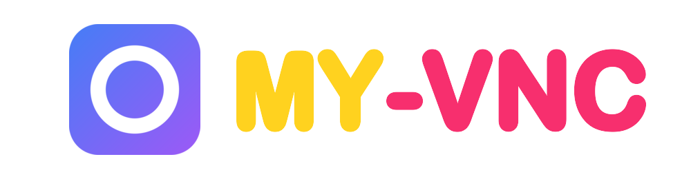

<div align="center">



**A fast VNC / Remote Desktop viewer for Windows, in pure Go.**

English · [简体中文](README.zh-CN.md)

</div>

MyVNC is a native Windows viewer for VNC (RFB) and Microsoft Remote Desktop
(RDP), built with pure Go and [MyGo](https://github.com/egoist/mygo) — no
Electron, no runtime dependencies. It is a port of the
[TigerVNC](https://github.com/TigerVNC/tigervnc) viewer, extended with an
Apple Remote Desktop high-performance media path, adaptive video quality,
and file transfer.

## Highlights

- **Two protocols, one app.** Standard VNC sessions plus RDP by embedding
  the system Remote Desktop ActiveX control — enter `rdp://host[:port]` as
  the address. NLA, RemoteFX/H.264, audio and clipboard are handled by
  Windows itself.
- **Apple Remote Desktop High Performance.** HEVC 4:4:4 or H.264 over
  SRTP at the Mac's source frame rate, decoded on the GPU through Media
  Foundation (D3D11/DXVA), with NAT punch, packet reordering and AV1 when
  an MFT is installed. Verified live against macOS 27.2 at ~50 fps.
- **Adaptive quality.** Throughput, RTT and jitter are measured every
  update; JPEG quality tiers, H.264 bitrate and GOP follow the link.
  LAN / WAN / Mobile presets and a PiKVM-style video panel
  (mode, quality, max fps, GOP, display orientation).
- **Full TigerVNC protocol coverage.** RFB 3.3 / 3.7 / 3.8 and Apple
  3.889; None, VncAuth, Plain, VeNCrypt X509, RSA-AES, MSLogonII, ARD DH
  with session encryption; Raw, CopyRect, RRE, Hextile, Tight, ZRLE, ARD,
  MVS, H.264, AV1; QEMU extended keys, fence, continuous updates, remote
  resize, LED sync, QEMU audio.
- **File transfer with a Mac.** Drop files from Explorer onto the session
  to upload; the session menu downloads files, folders and symlinks.
  Windows clipboard files land in the Mac's Downloads folder.
- **Parsec-style UI.** Computer cards with live thumbnails, chrome-free
  sessions with an overlay panel, a stats HUD (fps, decode ms, bitrates,
  dropped frames), WinUI 11 look, light/dark/system theme.
  English and Simplified Chinese.
- **Safe by default.** Security-level indicator, weak-type refusal,
  certificate and host-key trust on first use, password warnings,
  logging to `myvnc.log`.

## Install

Grab `MyVNC-Setup-<version>-amd64.exe` (installer) or the portable
`MyVNC-<version>-amd64.exe` from
[Releases](https://github.com/si-mods/MyVNC/releases). Both are built and
checksummed by CI. No installation of runtimes is required.

## Usage

- Launch `MyVNC.exe`, add a computer, and click its card.
- Command line: `MyVNC.exe [host[:port]]` or `MyVNC.exe rdp://host[:port]`.
  TigerVNC-compatible options and `.tigervnc` files are supported
  (`MyVNC.exe -h` for the list).
- AI agents: `MyVNC.exe --mcp` runs an MCP server on stdio, with no window
  ([docs/MCP.md](docs/MCP.md)).
- In-session: overlay panel for stats and video settings;
  Ctrl+Alt+Del sends Ctrl+Alt+Del; right-click a home card to remove it.

## Build

Requires Go 1.27+ and Windows.

```
go tool mygo dev     # run with live reload
go test ./...        # tests
go tool mygo build   # build exe + installer into build/
```

## Documentation

| Doc | Contents |
|---|---|
| [docs/MCP.md](docs/MCP.md) | `MyVNC.exe --mcp`: MCP server for AI agents |
| [docs/rdp.md](docs/rdp.md) | RDP sessions: usage, credentials, limits |
| [docs/bandwidth.md](docs/bandwidth.md) | Link measurement, quality policy, server-side requirements |
| [docs/ard-drag.md](docs/ard-drag.md) | ARD drag-and-drop and file transfer internals |
| [docs/RELEASING.md](docs/RELEASING.md) | Release workflow |
| [ROADMAP.md](ROADMAP.md) | Version history, known limits, open work |

## License

GNU General Public License, version 2 — see [LICENSE](LICENSE).

Portions derived from TigerVNC, Copyright (C) 1999-2025 TigerVNC Team and
many others (see individual files), and from TightVNC/RealVNC code it
contains. Third-party projects and licenses:
[README.third-party.md](README.third-party.md).

## Acknowledgements

TigerVNC (viewer core), remotex (ARD media), MyGo & Onevra (UI), purego,
go-text/typesetting, golang.org/x/image & x/text, Lucide (icons), FFmpeg,
PyCryptodome, Parsec (UX inspiration). Full attribution in
[README.third-party.md](README.third-party.md).
